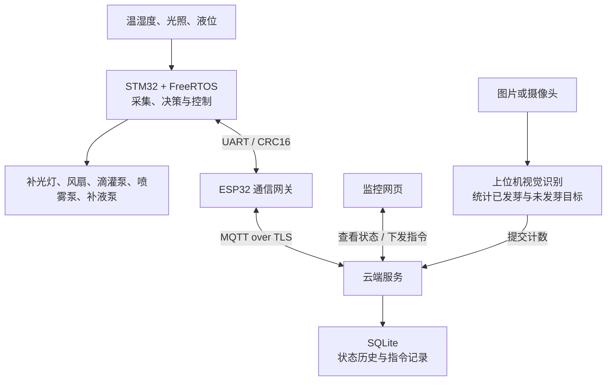

# 智能种植系统

本项目将环境采集、自动控制、远程监控和种子发芽识别连接起来：STM32 根据温湿度、光照和液位控制种植环境，上位机通过图像识别计算发芽率，STM32 再结合发芽率选择滴灌或喷雾。

当前参考实现采用 STM32F407 + FreeRTOS、ESP32、Mosquitto、Python 和 SQLite，视觉模块采用 Simplify YOLOv5s。

## 整体工作流程



系统有两条协同工作的链路：本地控制链路持续读取传感器并调节环境；远程链路负责展示状态、修改参数和传递发芽率。Wi-Fi 或云端断开时，STM32 仍继续执行本地自动控制。

## 各模块如何分工

| 模块 | 主要职责 |
|---|---|
| STM32 + FreeRTOS | 读取传感器，运行控制规则，统一操作 GPIO/PWM，执行水泵保护 |
| ESP32 | 连接 Wi-Fi 和 MQTT，在云端消息与 STM32 串口帧之间转发 |
| 云端服务 | 校验请求，保存状态与指令记录，将远程操作发送给设备 |
| 监控网页 | 展示实时状态、历史趋势和告警，提供参数设置与限时手动控制 |
| 上位机视觉模块 | 从图像中检测目标，统计发芽情况，将计数交给云端 |

STM32 负责最终的执行器决策。视觉模块更新发芽状态，ESP32 负责通信，云端负责远程交互。

## 本地控制逻辑

STM32 上的三个 FreeRTOS 任务通过队列交换数据：

| 任务 | 周期 | 工作内容 |
|---|---|---|
| `SensorTask` | 2 秒 | 读取 DHT11 温湿度和 BH1750 光照，更新最新采样 |
| `ControlTask` | 100 毫秒 | 读取液位、接收采样和指令，计算输出，执行保护，刷新看门狗 |
| `CommTask` | 约 5 毫秒轮询 | 解析串口指令、传递确认，并每秒发送一次设备状态 |

每轮控制先检查数据是否有效，再根据自动规则或手动指令生成期望输出，最后经过液位检查、泵互斥和时间限制，才写入 GPIO/PWM。执行器由控制任务统一操作。

自动模式下的默认规则如下，阈值可通过云端修改：

| 输入 | 决策 |
|---|---|
| 温度 | 达到 28°C 开风扇，降到 26°C 关风扇，中间区间保持原状态 |
| 空气湿度 | 降到 50% 时产生补水请求，升到 70% 时取消请求，中间区间保持原状态 |
| 光照 | 目标为 10000 lx；低于目标的 90% 增加补光，高于 110% 减少补光，每次新采样调整 5 个百分点的 PWM 占空比 |
| 发芽率 | 有补水请求时，低于 80% 或未知则选择滴灌，达到 80% 则选择喷雾 |
| 液位 | 缺液时停止滴灌与喷雾；缺液信号稳定 300 毫秒后允许补液，达到液位检测点后停止补液 |

温度与湿度分别使用开启和关闭阈值，减少临界值附近的反复开关。这里的湿度来自空气温湿度传感器；上述阈值是工程默认值，实际使用时需要按作物和设备校准。

## 发芽识别如何参与灌溉

上位机对每张图像检测两类目标：`alive` 表示已发芽，`dormant` 表示未发芽。发芽率按当前图像的检测结果计算：

```text
发芽率 = 已发芽目标数 ÷（已发芽目标数 + 未发芽目标数）× 100%
```

例如，一张图中检测到 18 个已发芽目标和 2 个未发芽目标，发芽率为 90%。上位机向云端提交已发芽数和总数，云端换算为发芽率指令，经 MQTT 和 ESP32 发送给 STM32。

STM32 保存这次结果后，在存在补水请求且液位、冷却时间等条件允许时选择喷雾。湿度已经足够时，更新发芽率不会直接启动水泵。

每帧单独统计，不跨帧累加。没有检测到目标时跳过上报；设置预期目标总数后，数量不匹配也跳过上报。发芽结果超过 30 分钟未更新时，STM32 将其视为未知，自动模式下有补水请求时选择滴灌。

识别流程见 [视觉模块逻辑](vision/README.md)。真实识别需要已训练的兼容权重，仓库提供模型配置、训练和推理代码。

## 远程操作如何到达设备

网页的参数设置、限时手动控制和视觉模块的发芽率更新，共用同一条指令链路：

1. 云端校验身份、参数和设备在线状态。
2. 为指令分配递增编号，绑定 STM32 本次启动编号，设置 10 秒有效期。
3. ESP32 检查有效期与设备状态，将消息转换为带 CRC16 校验的串口帧。
4. STM32 通信任务把指令放入队列，控制任务检查参数、编号和剩余有效期后处理。
5. STM32 返回确认，云端记录结果；后续状态上报反映控制器的实际输出。

ESP32 未收到确认时最多发送 3 次；STM32 识别重复编号，避免重试重新启动水泵或延长手动控制。云端返回 `sent` 表示指令已发出，最终处理结果需要查看指令记录。

## 异常与保护逻辑

| 情况 | 处理方式 |
|---|---|
| 滴灌或喷雾持续运行 | 每次最多运行 5 秒，同一泵停止后至少等待 60 秒再启动 |
| 补液后仍然缺液 | 连续补液 20 秒后停止并锁定故障，检查供液条件后可通过网页清除 |
| 多路泵同时被请求 | 滴灌与喷雾互斥，补液与灌溉互斥 |
| 环境采样超过 6.5 秒未更新或对应传感器无效 | 自动模式关闭对应的风扇、灌溉或补光输出，并产生告警 |
| 手动控制到期 | 手动模式允许持续 1–30 秒，到期恢复自动模式；期间仍执行液位和水泵保护 |
| Wi-Fi 或 MQTT 断开 | 本地控制继续运行，重连后恢复最新状态上报；断网期间的完整历史不补传 |

设备重启后，控制参数与发芽状态恢复固件默认值；云端的历史状态和指令记录保存在 SQLite 中。上报的执行器状态表示 GPIO/PWM 输出，当前硬件没有水流或电机转动反馈。

## 从哪里阅读代码

| 文件 | 对应逻辑 |
|---|---|
| [stm32/src/app.c](stm32/src/app.c) | 三个 FreeRTOS 任务及队列协作 |
| [common/planter.c](common/planter.c) | 自动规则、手动模式、发芽联动与水泵保护 |
| [stm32/src/board.c](stm32/src/board.c) | 传感器采集、GPIO/PWM 与串口驱动 |
| [common/protocol.c](common/protocol.c) | 串口帧编码、解析与 CRC 校验 |
| [esp32/src/main.cpp](esp32/src/main.cpp) | Wi-Fi、MQTT、串口转发与指令重试 |
| [cloud/app.py](cloud/app.py) | HTTP 接口、状态接收与指令下发 |
| [cloud/storage.py](cloud/storage.py) | 状态历史与指令记录存储 |
| [vision/infer.py](vision/infer.py) | 图像检测、计数与云端上报 |

接线、编译、部署和联调步骤见 [使用说明](USAGE.md)，构建与验证记录见 [VALIDATION.md](VALIDATION.md)。
