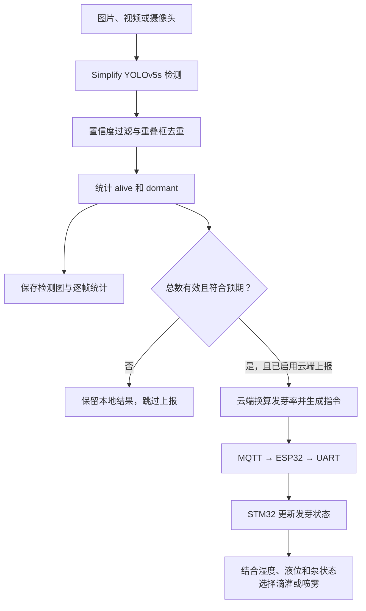

# 种子发芽识别与灌溉联动

视觉模块负责从种植图像中识别已发芽与未发芽目标，统计发芽率，并将计数提交给云端。STM32 收到云端转发的发芽率后，结合湿度、液位和水泵保护条件选择灌溉方式。

模型训练和图像推理运行在上位机。整个系统的模块分工见 [项目说明](../README.md)。

## 从图像到控制的流程



## 模型如何得到

训练前，先为原始图片标注目标框和类别：

| 类别编号 | 名称 | 含义 |
|---|---|---|
| 0 | `alive` | 已发芽目标 |
| 1 | `dormant` | 未发芽目标 |

数据准备脚本检查标注类别、坐标范围和边框是否越界，再将原图划分为训练集、验证集和测试集，默认比例为 70%、10%、20%。训练集用于学习参数，验证集用于选择模型，独立测试集用于评估识别效果。

模型基于 YOLOv5s，将主干四处 C3 模块在配置中的重复次数由 `3/6/9/3` 调整为 `2/3/4/2`，输出类别改为两类。构建网络时还会应用深度缩放系数 `0.33`，因此配置次数与实际重复次数不同。具体配置见 [simplify_yolov5s.yaml](models/simplify_yolov5s.yaml)。

训练阶段使用 Mosaic-9，将九张训练图像组合后参与训练，增加目标在不同位置、尺度和背景下的变化。先划分原图，再进行训练增强，独立测试集保持独立。

训练得到的权重文件由推理程序加载。仓库包含模型结构与训练流程；实际识别需要真实图片、标注以及训练后的兼容权重。

## 每一帧如何识别

[infer.py](infer.py) 对输入图像依次执行以下步骤：

1. 调整图像尺寸并将像素归一化，送入已加载权重的模型。
2. 按置信度过滤候选框，再用非极大值抑制（NMS）去除高度重叠的框。
3. 统计剩余框中的 `alive` 数量和 `dormant` 数量。
4. 计算发芽率，绘制检测框，保存本帧结果。
5. 检查上报条件；满足条件且达到上报间隔时，将计数提交给云端。

默认置信度阈值为 0.25，NMS 的 IoU 阈值为 0.45。去重时统一处理两个类别，减少同一位置同时留下“已发芽”和“未发芽”两个框的情况。

默认输出目录为 `vision/runs/detection/`：`latest.jpg` 保存最近一帧的检测图，`results.jsonl` 追加记录每帧计数、发芽率和上报结果。

## 发芽率如何计算

[logic.py](logic.py) 使用当前图像中检测到的两类目标计数：

```text
总数 = alive 数量 + dormant 数量
发芽率 = alive 数量 ÷ 总数 × 100%
```

例如，检测到 18 个 `alive` 和 2 个 `dormant`，本帧总数是 20，发芽率是 90%。

每帧独立计算。同一批种子在下一帧再次被检测到时，不会累加为新的种子。总数为零时，发芽率记为未知，跳过云端上报。

## 哪些结果可以上报

| 条件 | 处理 |
|---|---|
| 至少检测到一个目标，且未指定预期总数 | 允许上报 |
| 指定了预期总数，检测总数与其一致 | 允许上报 |
| 指定了预期总数，但检测数量不一致 | 保存本地结果，跳过上报 |
| 没有检测到目标 | 保存空检测结果，跳过上报 |
| 尚未配置云端地址 | 只做本地识别和结果保存 |
| 本次上报遇到网络错误 | 记录错误，继续本地识别 |

例如设置 `--expected-total 20` 后，只有检测总数为 20 的结果可以上报。这个值用于检查明显的漏检或重复计数，发芽率的分母仍然是实际检测总数；数量一致也不能保证每个目标都识别正确。

摄像头默认每 2 秒检测一次，云端上报尝试之间至少间隔 30 秒，减少重复请求。

## STM32 如何使用识别结果

上位机调用 `POST /api/germination`，提交已发芽数量和总数。云端校验请求，将结果换算成精度为 0.1 个百分点的发芽率，经 MQTT、ESP32 和串口传给 STM32。

STM32 在自动模式中先根据空气湿度判断是否需要补水，再使用有效发芽率选择方式：

| 条件 | 灌溉选择 |
|---|---|
| 没有补水请求 | 不启动滴灌或喷雾 |
| 有补水请求，发芽率低于默认阈值 80% | 选择滴灌 |
| 有补水请求，发芽率达到 80% | 选择喷雾 |
| 有补水请求，发芽率未知或超过 30 分钟未更新 | 选择滴灌 |

选定方式后，还要通过液位检查、泵互斥、单次运行时间和冷却时间限制，才会启动对应水泵。例如发芽率达到 90%，但水箱缺液时，喷雾泵仍保持关闭。

云端响应 `sent` 表示指令已发出。是否被 STM32 接受，需要查看网页中的指令记录与后续状态。

## 代码入口

| 文件 | 作用 |
|---|---|
| [prepare_data.py](prepare_data.py) | 校验标注并划分数据集 |
| [bootstrap.py](bootstrap.py) | 准备固定版本的 YOLOv5 依赖及 Mosaic-9 |
| [train_model.py](train_model.py) | 加载模型配置，执行训练并保存权重 |
| [evaluate.py](evaluate.py) | 使用验证集或独立测试集评估权重 |
| [infer.py](infer.py) | 读取输入、检测目标、保存结果并调用云端 |
| [logic.py](logic.py) | 计数、计算发芽率、检查上报条件和发送请求 |
| [../common/planter.c](../common/planter.c) | 在 STM32 端执行发芽率与灌溉联动 |

安装、数据格式、训练、推理命令与依赖许可见 [视觉模块使用说明](USAGE.md)。
